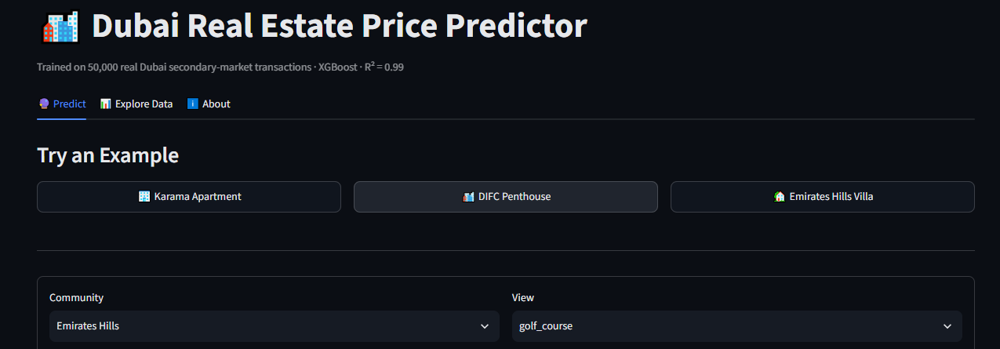
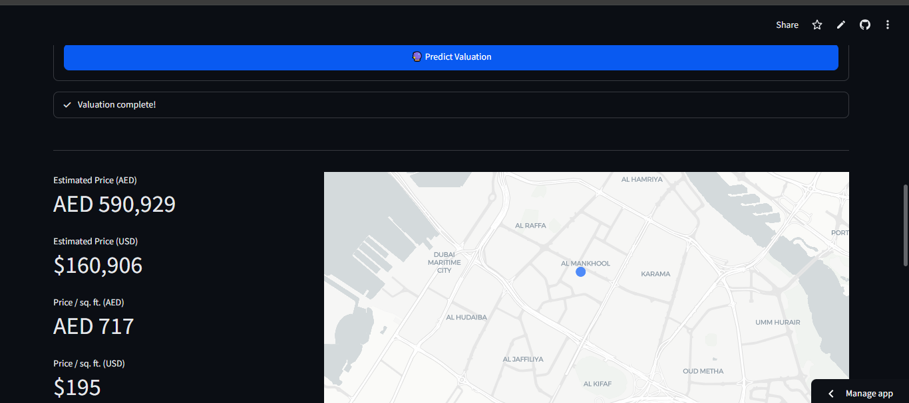
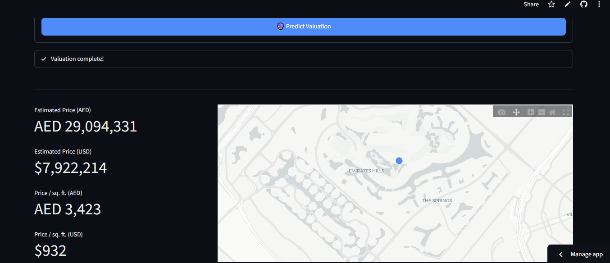
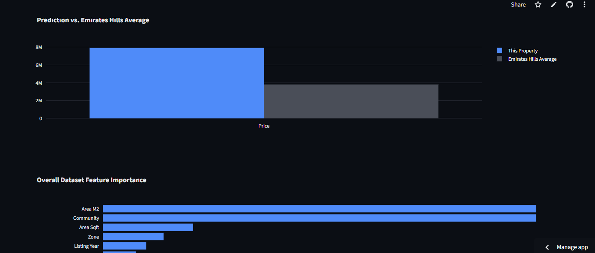

# 🏙️ Dubai Real Estate Price Predictor

An end-to-end machine learning project that predicts Dubai secondary-market property prices, from raw data to a live, deployed, interactive web app.

**🔮 Live App:** [dubai-real-estate-predictor.streamlit.app](https://dubai-real-estate-predictor.streamlit.app/)
**⚙️ API Docs:** [dubai-real-estate-predictor.onrender.com/docs](https://dubai-real-estate-predictor.onrender.com/docs)

> Note: the API runs on a free-tier server that sleeps after inactivity — the first request may take ~30-45 seconds to respond while it wakes up.



---

## Overview

This project predicts prices for Dubai properties using a public **synthetic** dataset of 50,000 listings (2020–2026). It covers the full ML lifecycle: data cleaning, feature engineering, model comparison, leakage checks, time-based validation, deployment, and a production-style frontend — not just a notebook.

**Key result:** On a time-based hold-out (trained Jan 2020 – Jan 2025, tested Jan 2025 – Apr 2026), Random Forest and XGBoost both reach **R² ≈ 0.95** on dollar prices, well above Linear Regression (0.84). The deployed model is XGBoost.

## Limitations

The data is synthetic: listing characteristics and prices come from a hedonic pricing model with real-world anchors. High scores show the model recovers that pricing structure, not accuracy on real sales. A real-data version would use Dubai Land Department transaction records. Predictions in the app are illustrative, not valuations.

## Tech Stack

| Layer | Tools |
|---|---|
| Data & Modeling | Python, Pandas, NumPy, scikit-learn, XGBoost |
| Backend API | FastAPI, deployed on Render |
| Frontend | Streamlit, deployed on Streamlit Community Cloud |
| Visualization | Plotly |

## Approach

1. **Data cleaning** — handled structural missing values (villas have no floor number, flagged with `has_floor_info`) and dropped price-derived columns (price per sqft and per m²) to avoid target leakage
2. **Feature engineering** — target encoding, fitted on training data only, for high-cardinality categoricals (84 communities, 55 metro stations, zones); one-hot encoding for the rest; log-transformed price target to correct right-skew
3. **Model comparison** — Linear Regression, Random Forest, and XGBoost on a random 80/20 split (10,000 held-out listings):

| Model | R² (log price) | Median $ Error |
|---|---|---|
| Linear Regression | 0.962 | $68,690 |
| Random Forest | 0.981 | $48,235 |
| **XGBoost (deployed)** | **0.990** | **$36,748** |

4. **Validation** — checked for leakage (no duplicate feature rows, single-feature scan, encodings fitted after the split), then re-tested all three models with a time-based split (trained on Jan 2020 – Jan 2025, tested on Jan 2025 – Apr 2026), which is the more honest estimate:

| Model (time-based hold-out) | R² (log price) | R² (dollars) | Median $ error |
|---|---|---|---|
| Linear Regression | 0.942 | 0.837 | $123,777 |
| Random Forest | 0.982 | 0.946 | $57,599 |
| XGBoost (deployed) | 0.974 | 0.951 | $71,383 |

   Random Forest and XGBoost perform similarly and both clearly beat Linear Regression. The random split flattered all three models, so the time-based numbers are the ones to trust.

5. **Deployment** — trained model served via a FastAPI `/predict` endpoint, consumed by a Streamlit frontend with dropdown-based inputs (sourced from dataset values, not free text), interactive maps, and comparison charts

### Example prediction

Predicting a 1-bedroom apartment in Karama — the model estimates **$160,906**; the dataset lists $167,100 for that property. This example is illustrative and may be part of the training data.



### Example: high-value property

A 5-bedroom villa in Emirates Hills, shown against the community average and the model's overall feature importance:




## What drives the model

In the final XGBoost model, property size (about 42% of feature importance) and community (about 35%) are the strongest drivers, followed by zone, listing year, and the mortgage rate at listing.

## Run locally

```bash
git clone https://github.com/Alaa-elden-mohammed/Dubai-real-estate-predictor.git
cd Dubai-real-estate-predictor
pip install -r requirements.txt

# Run the API
uvicorn api:app --reload

# In a separate terminal, run the frontend
streamlit run app.py
```

## Dataset

[Dubai Real Estate: Sales & Rentals (2020–2026)](https://www.kaggle.com/datasets/sergionefedov/dubai-real-estate-sales-and-rentals-20202026) — Kaggle, synthetic dataset; this project uses the 50,000-row secondary-sales file across 84 Dubai communities.

## Author

Built by **Alaa** — [GitHub](https://github.com/Alaa-elden-mohammed)
